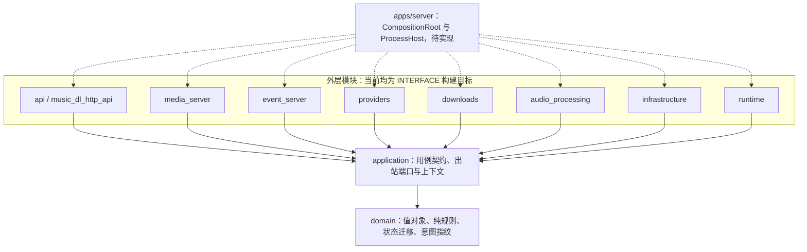
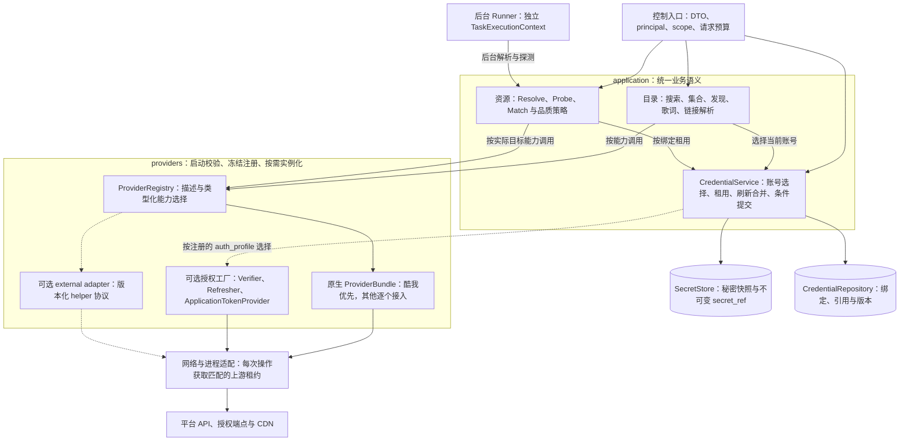
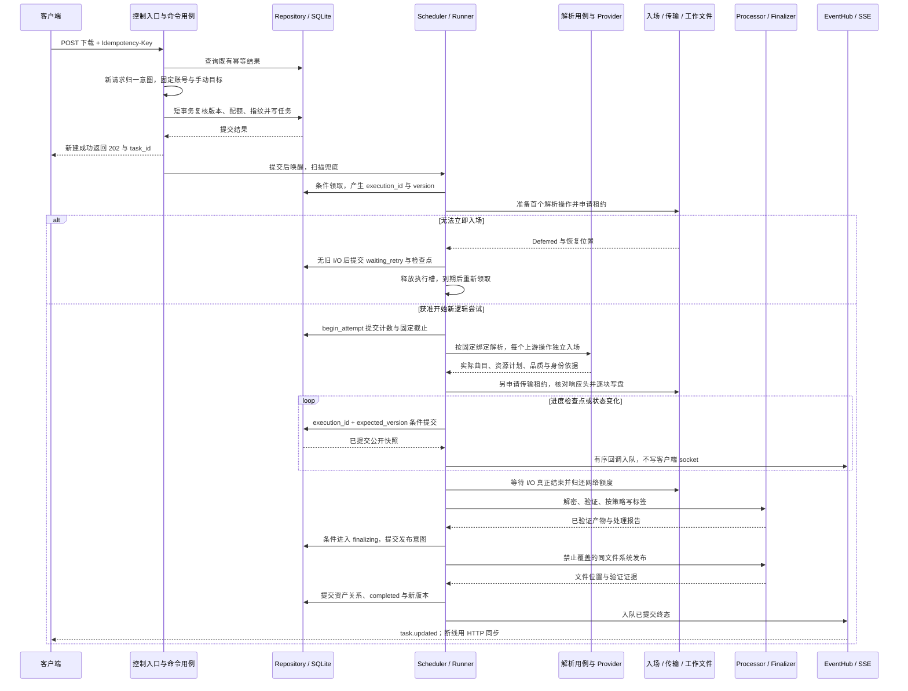
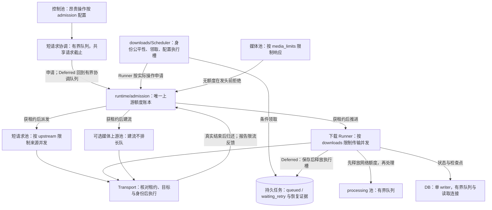
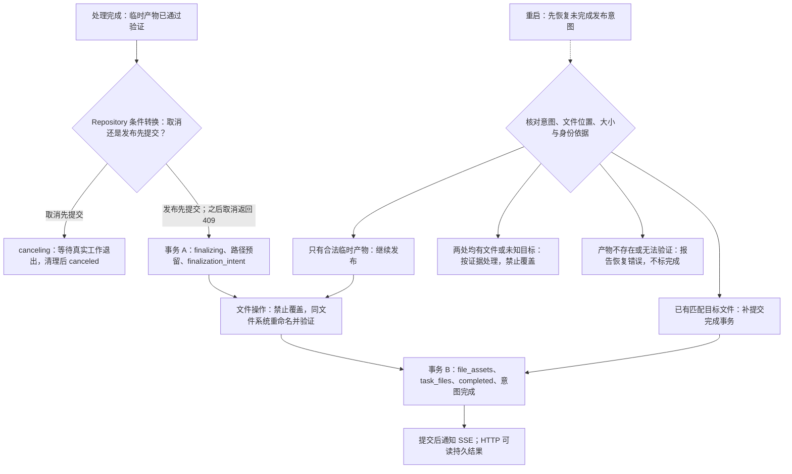
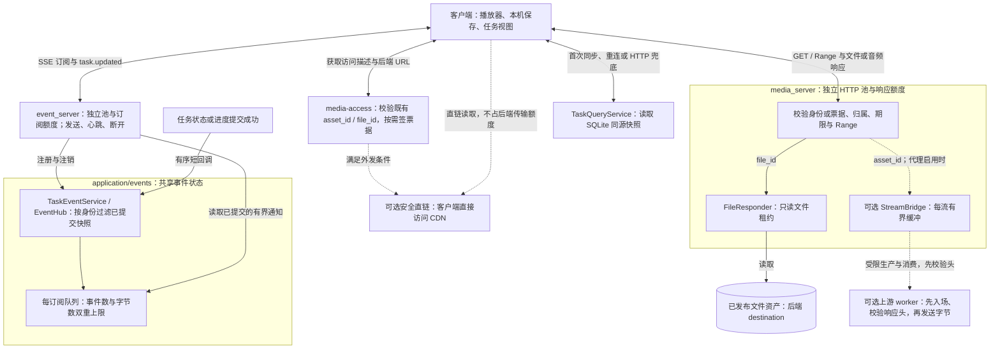

# C++20 后端详细架构图

更新：2026-10-19。总体评估与图 1 见[架构评估与总览](architecture.md)。本页依据当前工作区设计规范绘制；除图 2 的 CMake 依赖已有骨架外，业务组件均待实现，不代表已完成运行验证。

所有视图已导出为可缩放 SVG，见[图集](diagrams/README.md)。本页 Mermaid 是图 2～7 的编辑源，修改后按图集中的命令重新生成。

| 视图 | 主要问题 | 箭头语义 |
| --- | --- | --- |
| [图 2：编译依赖](#图-2编译依赖与依赖倒置) | 哪个模块依赖哪个模块？ | 实线为现有目标依赖，虚线为待实现组装 |
| [图 3：用例与平台](#图-3应用用例平台能力与授权) | 谁负责业务规则、平台协议和账号？ | 运行调用，虚线为可选扩展 |
| [图 4：下载时序](#图-4从接收下载到发布文件) | 任务如何持久化、执行和完成？ | 时间顺序、调用与返回 |
| [图 5：调度与资源](#图-5执行器上游额度与背压) | 执行槽和网络额度如何分开管理？ | 派发、申请、反馈与持久延后 |
| [图 6：发布与恢复](#图-6文件发布取消与崩溃恢复) | 文件与数据库之间崩溃怎么办？ | 正常步骤与分支，虚线为恢复入口 |
| [图 7：媒体与事件](#图-7文件在线媒体与任务事件) | 文件、音频和任务进度如何到客户端？ | 请求、字节与通知，按边标签区分 |

图按问题拆开；省略重复连线不表示绕过授权、端口或资源预算。Service 是进程内用例名称，不表示独立服务。可选能力必须按阶段验证后启用。

## 图 2：编译依赖与依赖倒置

[打开 SVG](diagrams/detail-1.svg)

实线对应 `cpp/src/*/CMakeLists.txt` 的直接业务目标依赖，省略统一编译选项 target 及 domain 的传递依赖。组装层也负责构造应用用例，图中省略这条重复组装关系。`apps/server` 当前只有预留 CMake 文件，没有 `music-dl-server` 可执行目标。

**application 运行时调用 Provider，但不编译依赖具体 providers 实现。** 应用层声明端口，外层实现它，组装层注入具体对象。同理，任务创建通过 DownloadQueuePort 唤醒下载模块；Runner 通过应用契约调用解析用例，双方不包含对方的具体实现。

实际源码加入后，公共头只暴露项目类型，第三方依赖按 PUBLIC／PRIVATE 隔离。不能仅靠当前统一 include 根目录和空 INTERFACE target 证明这些约束已经生效。详见[模块与目录](backend-service/modules-and-layout.md)。

## 图 3：应用用例、平台能力与授权

[打开 SVG](diagrams/detail-2.svg)

AccountBinding 固定账号选择；AuthIdentityKey 包含绑定与本次完整授权版本。缓存、游标、上下文、在途合并和连接隔离共用该身份，不能只用相同的 version 值区分不同账号。平台能力取得只读秘密快照，不能写凭证表或 SecretStore；CredentialService 负责刷新合并与条件提交。

Provider 只解释平台请求、签名、响应及能力，不拥有通用换源策略、任务队列或文件发布。目录源和实际音频源分开保存：未来目录型来源由 MatchService 明确选择目标后，再调用目标来源 IAssetResolver，不能在 Provider 内部偷偷跨源递归。

首版静态注册原生平台。helper 默认关闭，启用后也共用公共 Runner、临时工作区、取消、配额与 Finalizer；不引入第二套持久队列。授权工厂、处理器注册、扩展传输类型和新增平台验收详见[多平台扩展](backend-service/provider-extensibility.md)。

## 图 4：从接收下载到发布文件

[打开 SVG](diagrams/detail-3.svg)

图展开新任务路径；幂等命中直接返回既有结果。创建、领取、开始尝试、检查点、发布意图、完成发布各自是短事务，均不包住网络或文件处理。图把入场与传输归在一个参与者：实际额度属于 runtime，I/O 属于适配器，准备阶段与实际执行之间通过应用契约协调。

`attempt` 是逻辑尝试次数，`execution_id` 是领取世代，`version` 是持久快照版本。入场延后不消耗新尝试次数，重新领取更换执行世代；旧回调不得覆盖新执行。图只展开首个操作的 Deferred 分支，后续解析、探测、传输也遵守相同规则；进入 processing 前已释放网络额度。完整契约见[内部接口](backend-service/internal-contracts.md)。

关闭客户端只会断开响应或通知，不取消已提交任务。任务事件可能早于创建响应到达，客户端按 task_id 与 version 合并。

## 图 5：执行器、上游额度与背压

[打开 SVG](diagrams/detail-4.svg)

配额数值统一见[配置基线](backend-service/configuration-and-deployment.md#配置来源与生效时机)，图只表示职责；媒体上游随在线代理能力启用。admission 的输出表示获得资格后的派发关系，不表示它解释或领取任务。并发租约、速率冷却、物理连接池容量和下载执行槽分别管理。Provider 内部准备下一条网络操作时同样非阻塞入场，不能在 worker 内等平台 semaphore。

允许的等待方向是控制 → 短请求、下载 → processing／DB。禁止反向等待、同池提交后阻塞等子任务，以及持锁或持数据库事务等 I/O。processing 可以占用下载执行槽，但不能继续占用下载网络租约。

Deferred 持久延后之前必须确认旧 I/O 结束；DB 提交失败不能先释放执行所有权。重定向每跳重新校验和入场；停止信号、HTTP 已返回和真正 I/O 结束不是同一时刻。外部 helper 按已验证的连接上界联合预留，实际退出后归还。完整规则见[运行时](backend-service/runtime-and-tasks.md)。

## 图 6：文件发布、取消与崩溃恢复

[打开 SVG](diagrams/detail-5.svg)

SQLite 与文件系统之间没有跨资源原子事务。发布意图让崩溃窗口可识别、可验证和可继续；无法确认产物时报告错误，而不是猜测成功。DB 已提交但 SSE 通知失败不回滚任务；关闭受影响订阅，让客户端重新查询。

恢复不仅检查 `.part` 长度，还检查任务版本、资源身份和产物依据。工作区在 destination 内，不能默认放在可能跨文件系统的 data_dir。其他阶段的恢复和停机规则见[运行时](backend-service/runtime-and-tasks.md#崩溃恢复与优雅退出)，发布故障矩阵见[内部契约](backend-service/internal-contracts.md#7-文件发布与崩溃矩阵)。

## 图 7：文件、在线媒体与任务事件

[打开 SVG](diagrams/detail-6.svg)

文件发送不占媒体上游线程。代理必须先核对上游状态与 Range 再向下游发头，缓冲满时限制生产者继续读取；客户端断开只取消这一次流。直链默认关闭，需秘密请求头的资源不能外发。播放位置、暂停、音量、解码与本机写盘进度属于客户端。

SSE 可以合并未发送进度，但不能静默丢弃终态；超限时关闭订阅，重连后先收到 ready，再读取列表及已经追踪的任务，按 version 合并事件。首版不建持久事件日志，也不依赖 SSE 保证任务执行。**后端 completed、媒体传输结束、客户端保存成功是三个不同事实。**

## 状态归属与生命周期

| 数据或状态 | 权威持有者 | 重启与对外边界 |
| --- | --- | --- |
| principal、token 哈希、scope | SQLite 身份记录 | 引导文件只做一次性交付 |
| 凭证描述、稳定绑定、版本 | CredentialService + Repository | 秘密放 SecretStore，对外仅去敏描述 |
| 任务、规范意图、attempt、deadline、version | SQLite 任务与尝试记录 | 新领取产生 execution_id，旧执行不得写入 |
| 批次与任务关系 | batch_items | 多批可引用同任务，取消真实任务影响全部引用 |
| 文件资产、任务文件关系、发布意图 | SQLite + 经核验的实际文件 | file_id 与 task_id 分开，路径不是客户端本机路径 |
| context、cursor、asset、match、媒体票据 | 有界内存句柄与缓存 | 重启失效，持久任务不依赖短期句柄续命 |
| ProviderRegistry | 组装层创建的不可变对象 | 启动校验、按需实例化，首版不热加载 |
| 网络租约、执行句柄、订阅、StreamBridge | runtime 与当前操作 | 不恢复旧网络租约，实际退出才释放 |
| 播放位置、本机保存进度 | 外部客户端 | 不写入 DownloadTask 或另建后端播放会话 |

字段和关系以[数据模型](backend-service/data-models.md)为准，事务和所有权以[内部契约](backend-service/internal-contracts.md)为准。图用于解释规范，不另建第二套 API 定义。
