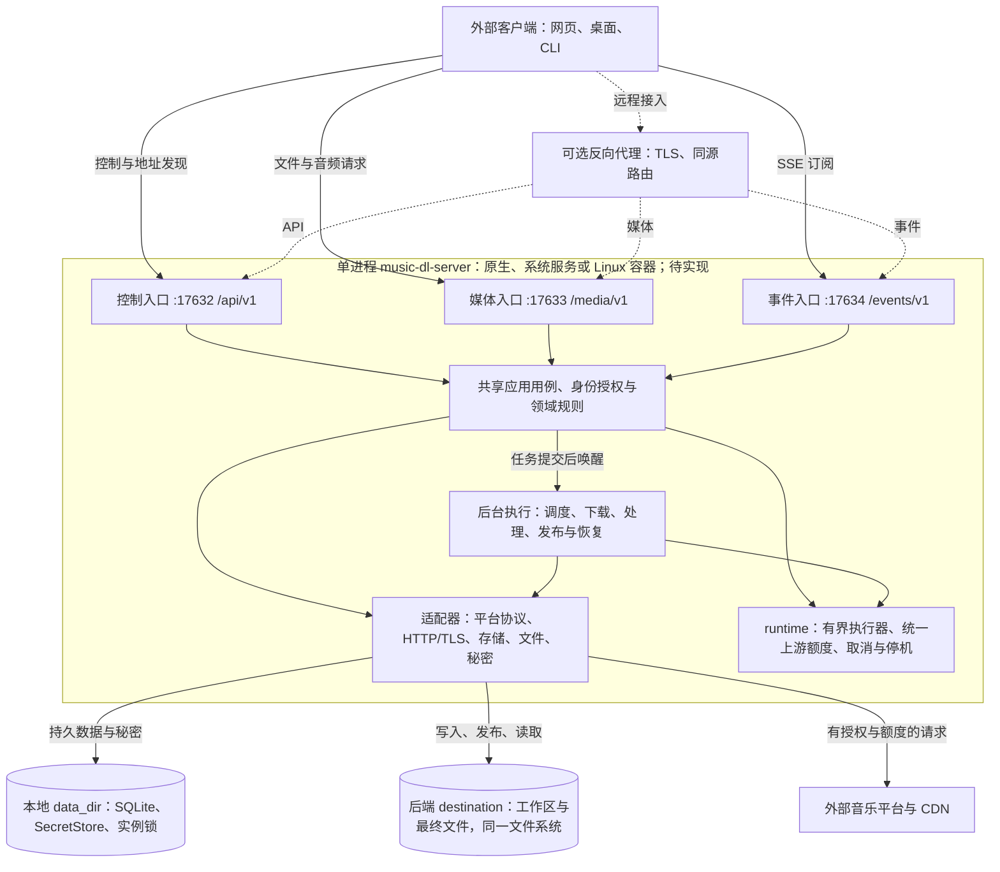

# C++20 后端架构评估与总览

更新：2026-10-19。评估依据是当前工作区的设计规范与 CMake 骨架，包含未提交改动。**目前没有业务 C++ 源码、可执行服务或运行测试；下图表示待实现的目标架构。** 第三方参考仓库不计入本项目实现。

本页提供评估与系统总图；[详细架构图](architecture-details.md)继续展开编译依赖、用例与平台、下载时序、执行资源、发布恢复、媒体与事件六个视图。阶段关口以[开发任务清单](development-tasks.md#总体顺序与交付关口)为准。

## 架构是否合理

**总体合理，建议保留“单进程模块化后端 + 端口与适配器 + 持久下载任务”的方向，先完成酷我最小闭环。** 当前模块基本对应不同生命周期、状态归属和替换点；主要风险是实现复杂度与验证成本，不是模块数量不足。现阶段无需因平台数量增加而引入微服务或分布式消息队列。

| 设计选择 | 判断与理由 | 限制或验证条件 |
| --- | --- | --- |
| domain／application／适配模块 | 合理；纯规则与外部协议分离，平台、数据库、HTTP 可以分别替换 | INTERFACE 目标只表达依赖意图，还不能证明真实源码遵守边界 |
| 一个进程、三个入口 | 合理；控制、媒体、SSE 连接寿命不同，独立池限制相互占用 | 仍共享 CPU、磁盘、DB 与进程故障；三个监听不是三个服务 |
| SQLite 持久任务 + 内存唤醒 | 适合单实例目标；关闭客户端不影响任务，唤醒丢失可扫描恢复 | 一个 data_dir 只运行一个进程，DB 放在受支持的本地文件系统 |
| ProviderBundle 与小能力接口 | 合理；无需每个平台支持全部功能，目录源和音频源可分别接入 | 用第二个真实平台验证；不能在通用业务层增加平台名称分支 |
| 发布意图 + 独立文件资产 | 合理；下载完成、文件发布、客户端保存是不同事实 | 文件系统与 SQLite 没有共同原子事务，必须覆盖发布崩溃窗口 |
| SSE + HTTP 快照 | 合理；推送提供及时性，持久快照恢复当前状态 | 首版不保证事件历史重放，慢消费者断开后重新查询 |
| 阻塞 I/O + 有界执行池 | 可作为当前基线，尚不能认定性能足够 | 验证 TLS、真实取消、慢连接、等待关系、线程与内存预算 |
| OAuth、helper、跨源匹配 | 扩展位置明确，但全部提前实现会增加首版成本 | 保留契约，按阶段启用，不作为全部 S1 前置条件 |

## 仍需优先落实的事项

1. **把设计闭合与实现通过分开。** 最新[模块审查](backend-service/module-boundary-review.md#本轮模块与功能拆分审查)已将 R1～R4 标为设计补齐：规范化下载意图、完整授权身份、平台授权工厂、统一上游入场均有契约。A35～A46 已覆盖对应验收，不能再把它们当作尚未设计的缺陷，也不能据此宣称代码正确。
2. **先验证网络适配，再铺开业务。** 三个监听只解决入口线程隔离，不能自动解决 DNS／TLS 取消、同池等待、连接复用和慢消费者。按[实施计划](implementation-plan.md#网络检查)做可控上游验证，记录实际操作退出与额度归还。
3. **S1 就落实最小发布与恢复。** 关闭前端继续下载只是其中一项；还要验证取消／finalizing 竞争、文件移动后崩溃、DB 提交后通知失败和旧执行回调拒写。S3 再扩展续传、处理格式和故障覆盖，不能把最小一致性推迟。
4. **按目标设备确定资源配置。** 按[配置基线](backend-service/configuration-and-deployment.md#配置来源与生效时机)测量实际启用池、峰值内存、线程数与尾延迟，再形成普通主机和低资源 NAS 配置；工作线程配置之和不能当作实测常驻线程数。
5. **把编译边界变成源码约束。** 当前 CMake 依赖无业务环，但公共 include 根目录统一暴露。真实源码加入后，检查跨模块 include、PUBLIC／PRIVATE 与第三方类型泄漏；依赖图本身不能阻止错误包含。

上述是实施风险和验证关口，不是已经复现的运行缺陷。下一步应完成 S0／S1 的单平台闭环，再用第二个平台验证扩展边界，按测量结果调整容量。

## 服务形式

一个无 GUI 的跨平台常驻后端服务所有外部客户端。后台下载保存到后端目录，客户端另存是独立传输；播放器状态由前端管理。本项目不开发 GUI 或依赖前端运行时；静态网页托管如保留，仅为分发已有客户端资源的可选适配，反向代理或独立前端均可接入。

Windows、Linux、NAS 与 Docker 共用业务层和 API，系统接口限定在适配层，原生程序按目标系统和架构分别构建。支持矩阵和容器要求见[配置与部署](backend-service/configuration-and-deployment.md#部署方式)。

控制、媒体和 SSE 入口共享业务与存储，独立线程池隔离长连接。前端从配置或启动器取得 API 地址，再从 info 获取媒体／事件地址。NAS 路径与容器路径不作为客户端本机路径。

## 图 1：系统、进程与部署边界

导出图：[SVG](diagrams/overview-1.svg)／[PNG](diagrams/overview-1.png)。全部图见[图集与重新生成方法](diagrams/README.md)。

箭头表示请求或资源访问；虚线表示可选部署路径。进程内模块共享业务与存储，不是独立服务。

上图表示运行调用；编译依赖以[模块与目录](backend-service/modules-and-layout.md#依赖方向)为准，出站端口归 application。框架、JSON、数据库类型限定在适配层。控制请求与媒体连接各有取消期限，持久任务由后端独立管理。下载调度管理持久队列与执行槽，runtime/admission 统一管理每次实际上游操作的额度；执行与等待关系见[运行时](backend-service/runtime-and-tasks.md)。

图中的数据框不是独立数据库服务；Docker 需要持久化 data_dir 与 destination。客户端本机保存是从媒体入口获取文件的第二段传输。更多内部关系见[图 2～图 7](architecture-details.md)，各图均明确箭头语义与实现状态。

平台范围持续扩展，酷我先完成闭环。ProviderBundle 组合独立能力，目录源与实际音频源分开；Spotify 可先接目录，再通过显式匹配使用其他已验证音源。原生适配与可选外部 helper 共用端口及公共下载队列，不把平台名称分支扩散到业务层。注册、凭证、规模和兼容策略见[多平台扩展](backend-service/provider-extensibility.md)。

## 原实现映射

| C++ 模块 | 职责 | 参考位置 |
| --- | --- | --- |
| domain | 歌曲、集合、品质、错误与能力模型 | music-lib/model、provider |
| providers | 参数、签名、平台响应与能力差异 | music-lib/各平台 |
| application | 聚合、集合、解析、探测与匹配 | core/service.go、Web／TUI 编排 |
| infrastructure/transport | HTTP、TLS、Range、重定向与取消 | 平台 HTTP、BuildSourceRequest |
| downloads | 队列、临时文件、续传、恢复、去重 | core/download.go、下载记录 |
| audio_processing | 解密、格式、标签、封面与歌词 | core/service.go 元数据处理 |
| infrastructure/storage | 身份、任务、资产与发布意图 | SQLite 与本地存储 |
| api／media_server／event_server | HTTP、二进制与 SSE 协议适配 | internal/web，按新契约重写 |
| runtime | 有界执行器、额度、截止时间、停机 | C++ 服务新增 |

研究依据：[Go Music DL](../../research/go-music-dl/README.md)、[Lanyue](../../research/lanyue/README.md)。

## 迁移要求

- 各源分页、总数和错误分别保留；歌曲 ID 以 source + id 表示。
- 歌单／专辑详情与曲目分页分离，分类／榜单标记实时、内置或派生来源。
- 音源解析、可访问性、试听和格式完整性分别判断；保留未知值。
- 换源保留原曲与实际曲目，区分现场、翻唱、Remix 等版本。
- 音频逐块写盘，Range 续传核对资源身份；必要解密可先落盘后处理。
- 标签失败按策略报告，去重考虑来源、版本和品质。
- 保留原 Go 页面需另设兼容层；自建集合、本地音乐扫描、WebDAV、TUI 属于后续扩展。

## 实现入口

| 内容 | 规范 |
| --- | --- |
| 功能职责 | [功能模块](backend-service/feature-modules.md) |
| 目录与目标 | [模块与目录](backend-service/modules-and-layout.md) |
| 路由与字段 | [API](backend-service/api-contract.md)、[模型](backend-service/data-models.md) |
| 事务与恢复 | [内部契约](backend-service/internal-contracts.md) |
| 验证顺序 | [实施计划](implementation-plan.md) |
