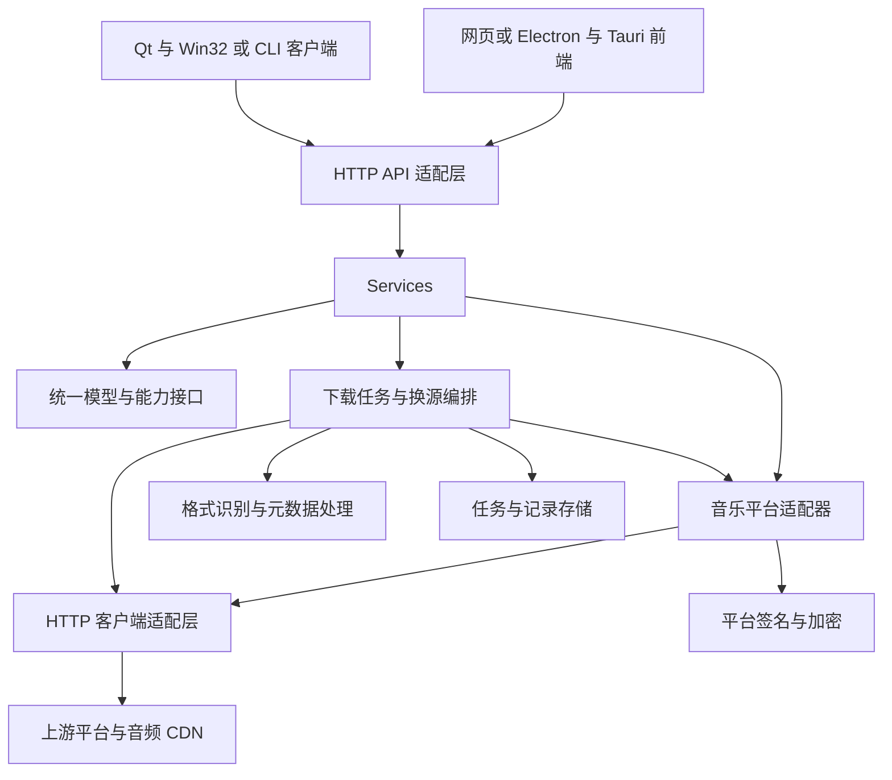

# C++20 重构架构

以独立业务核心组织搜索、集合详情、资源解析、换源和下载，让 HTTP 框架只承担协议接入与网络执行。当前暂定 cpp-httplib 提供 Server 与 Client 能力，Drogon 为备选；平台实现不直接依赖框架请求、响应或控制器类型。

状态：架构总览，主框架已暂定。详细模块、目录、类型、API 和执行规则见[后端服务详细设计](backend-service/README.md)；本页的概要以该目录为准。尚未创建 C++ 工程，TLS 与下载传输的具体组合仍需验证。

## 独立服务与多端接入

架构方向已明确：先开发可以无界面启动、长期运行的后端服务。音乐平台协议、搜索聚合、音源解析、下载队列、任务状态和凭证管理集中在后端；前端负责展示、用户操作与调用接口。

网页、Electron、Tauri、Qt、Win32 和 CLI 等客户端都使用同一套版本化 HTTP API。客户端通过服务地址和访问凭证接入，不需要各自实现平台搜索与下载协议。桌面应用可以打包后端并启动本机实例，也可以连接已经运行的远程实例。

| 运行方式 | 后端位置 | 客户端接入方式 |
| --- | --- | --- |
| 单机使用 | 用户电脑上的独立后端进程 | 本机网页或桌面程序连接本机服务 |
| 局域网共享 | 一台持续运行的电脑或服务器 | 多个前端连接同一个服务，权限与并发由后端管理 |
| NAS 部署 | NAS 上可运行的目标系统与架构 | 网页、桌面或其他客户端连接 NAS 服务地址 |
| Docker 部署 | 容器中的无界面后端进程 | 映射服务端口，持久化任务、配置和下载目录 |

NAS 是部署设备类型，Docker 是部署方式；二者也可以组合使用。跨端复用的是业务实现和接口契约，不表示一份 Windows 二进制可以直接运行在 Linux／ARM NAS 上，仍需对应构建产物与运行验证。

常驻运行依赖后端进程的部署与生命周期管理。启动即提供服务、系统启动时自动运行、异常退出后重启是不同能力；后续按目标环境提供启动配置或服务管理集成。正常关闭前端窗口不会取消已创建的下载任务；若桌面壳把后端作为子进程并随窗口一起退出，就无法满足这一语义，应明确配置管理方式。

### 服务接口与后台任务

搜索采用请求内返回结果的 HTTP 接口，并由服务端统一限制超时与上游并发。下载持久提交后返回任务 ID，由独立队列执行。首版采用 SSE 推送进度，同时保留 HTTP 任务列表及单任务状态、进度、结果和错误查询，用于初始加载、断线恢复和独立轮询客户端；取消使用 HTTP 命令。

同一进程内设置控制、媒体与 SSE 三套 cpp-httplib Server，默认监听 17632、17633、17634，各有独立线程池。媒体和事件长连接不占用控制 API 线程；下载平台音频也使用独立工作池。反向代理可统一域名，客户端从 info 获取媒体和事件地址。[运行时设计](backend-service/runtime-and-tasks.md)

多个前端连接同一实例时，共用该实例的任务存储与调度资源。服务端需要区分调用方和任务可见范围，客户端刷新页面或重新连接后仍可查询有权限的历史任务。

文件默认保存到**后端所在设备**配置的目录。远程客户端需要将文件保存到自己电脑时，再通过文件获取接口取回；后端 NAS 路径或容器内部路径不能直接当作客户端本地路径使用。接口使用任务 ID／文件 ID 标识资源，后端负责解析实际存储路径。

服务端可按需要提供静态网页，也允许前端独立部署。同源页面可直接访问 API；单独部署的网页、桌面 WebView 等入口需配置其实际来源及访问方式。对外共享时按部署范围配置监听地址、认证、权限与 TLS，不把桌面框架的 IPC 当作公共接口契约。

## 功能范围

| 功能 | 重构目标 | 迁移时需要保留的差异 |
| --- | --- | --- |
| 单曲搜索 | 单平台搜索、多平台聚合、分页、超时与部分结果 | 各平台总数、游标、失败原因分别返回 |
| 歌单搜索与详情 | 搜索歌单、读取信息与曲目、展开后复用歌曲操作 | 曲目列表可能分页或无法完整读取 |
| 专辑搜索与详情 | 独立专辑模型和接口，曲目复用歌曲模型 | 专辑艺术家、发行日期与歌单创建者语义不同 |
| 歌单分类 | 分类目录、分组、按分类读取歌单 | 真实分类、内置目录、搜索包装和采样结果分别标注 |
| 排行榜 | 榜单目录、详情和曲目、更新时间 | 部分平台使用内置榜单 ID，部分条目实际是推荐集合 |
| 资源解析与探测 | 解析地址、音质、格式、请求头和可用状态 | 可访问、可解码、整曲、试听是不同状态 |
| 下载 | 原始音频保存、流式写盘、进度、取消、续传、批量任务 | 加密音频和元数据写入需要额外处理阶段 |
| 换源 | 根据歌曲信息寻找其他平台的可用版本 | 同名、翻唱、Live、Remix、重制版不能仅按文本合并 |
| 凭证与辅助数据 | 按平台管理 Cookie，获取歌词和封面 | 登录方式、签名器、账号能力按平台配置 |

先迁移公共业务和平台能力，再扩展本地音乐、自建集合、WebDAV、TUI 或桌面外壳。这些扩展的位置预留在架构中，具体优先级另行确定。

原行为依据：[功能实现拆解](../../research/go-music-dl/README.md)。

## 分层与依赖方向



业务核心使用自己的歌曲、错误、请求选项和分页模型。框架请求、响应、协程任务类型与 JSON 类型在适配层转换，不作为平台模块的公共数据类型。

首轮以同步平台操作与有界任务调度组织业务，不先引入协程运行时。统一完成、失败、超时和取消语义，HTTP 适配层负责请求与任务生命周期。若后续采用 Drogon，再增加对应运行时适配，不将其协程类型提前传入业务公共接口。

## 模块职责与原实现映射

| 新模块 | 职责 | 原实现参考 |
| --- | --- | --- |
| `domain` | 歌曲、歌单、专辑、分页、错误、资源信息和能力声明 | `music-lib/model`、`music-lib/provider` |
| `providers` | 平台参数、签名调用、响应解析、来源能力和凭证使用 | `music-lib/<平台>` |
| `application` | 搜索聚合、集合展开、分类与榜单、探测、换源 | `core/service.go`、Web 与 TUI 业务编排 |
| `transport` | 普通 HTTP 请求、文件传输、连接复用、超时与取消 | 平台 HTTP 调用、`BuildSourceRequest`、Range 路径 |
| `downloads` | 任务队列、续传状态、临时文件、下载结果和去重 | `core/download.go`、下载记录和 Web 批量操作 |
| `media` | 文件特征识别、标签、封面、歌词和音频属性 | `core/service.go` 中的元数据处理 |
| `storage` | 下载记录、任务恢复、自建集合及配置持久化 | SQLite 与本地配置相关实现 |
| `api` | 路由、参数校验、JSON 转换、流式响应 | `internal/web` |
| `runtime` | 线程池、入场额度、截止时间、取消、启动与退出 | cpp-httplib 主方案的有界执行 |

目录概要如下；完整文件划分与构建目标见[模块与目录结构](backend-service/modules-and-layout.md)。本次只创建文档，未创建这些源代码目录：

```text
cpp/
  CMakeLists.txt
  CMakePresets.json
  include/music_dl/
    domain/
    application/
      ports/
  src/
    domain/
    application/
    providers/
    downloads/
    media/
    infrastructure/
    runtime/
    api/httplib/
    media_server/httplib/
  apps/server/
  tests/
    unit/
    integration/
    fixtures/
  cmake/
  packaging/
```

## 统一模型与能力接口

| 模型 | 关键内容 | 约束 |
| --- | --- | --- |
| `Track` | 来源、平台 ID、标题、艺术家、专辑、时长、版本信息、平台扩展数据 | ID 保持不透明字符串；跨平台身份使用来源与 ID 组合 |
| `Playlist` | 来源、ID、名称、创建者、封面、曲目数 | 详情与曲目分页分开获取 |
| `Album` | 来源、ID、名称、艺术家、发行日期、封面 | 不复用歌单创建者字段解释专辑艺术家 |
| `PageResult<T>` | 条目、总数是否已知、下一页游标、是否还有结果 | 页码和游标由各平台转换，禁止伪造全局总数 |
| `Category`、`Chart` | 来源、ID、名称、分组、更新时间、目录来源类型 | 标明实时获取、内置、搜索包装或采样 |
| `ResolvedAsset` | 临时 URL、必要请求头、实际音质、格式提示、有效期、试听与解密信息 | URL 不是永久歌曲身份；凭证和解密数据不直接暴露给普通 API 调用方 |
| `SourceResult<T>` | 某来源的数据、错误、耗时和分页信息 | 无结果与请求失败分开表达 |
| `DownloadTask` | 任务 ID、歌曲、期望和实际音质、状态、进度、结果文件、错误 | 可从浏览器之外创建和查询任务 |

平台按能力实现歌曲搜索、歌单、专辑、分类、榜单、资源解析、歌词和封面等接口，通过注册表声明实际支持项。不支持的能力返回明确的 `Unsupported`，不以空列表伪装成功。平台专有的 hash、mid 等信息随扩展数据保留，并限定在该平台适配器内解释。

## 搜索与集合调用

搜索流程为参数校验、选择来源、并发调用、统一模型转换、合并与返回。为每个来源设置超时，并设置整个请求的截止时间；一个来源失败时保留其他来源的结果和失败明细。

单平台分页直接对应平台页码或游标。多平台搜索返回各来源的继续加载信息，不先承诺一个准确的全局页码和总数。若后续需要全局稳定分页，应单独设计聚合游标或结果快照。

歌单与专辑详情返回集合信息和曲目分页；分类与榜单也经过相同的来源能力检查。前端和 CLI 通过公共 HTTP API 访问同一个服务，避免各入口分别实现换源或分页规则。

## 资源解析与换源

资源解析先根据歌曲与凭证取得音频候选，再构造来源要求的请求头并进行有限探测。Range 探测需限制实际读取量，避免上游忽略 Range 时下载完整音频；完整性无法确定时保留未知状态。

换源服务按以下顺序工作：

1. 归一化标题、艺术家、专辑和版本信息，保留 Live、Remix、翻唱等区别。
2. 在目标平台并发搜索，限制每首歌和每个平台的请求数。
3. 综合名称、艺术家、时长、版本和可用音质评分，过滤明显不一致的候选。
4. 对高分候选进行有限资源探测，依据匹配程度和可用性排序。
5. 返回候选、分数和匹配原因；低于最低置信度时返回未找到可靠替代。

自动换源和手动换源共用这一服务。提前得到结果后取消无用请求；换源结果保留原歌曲与替代歌曲的关系，下载记录明确标出最终来源。

## 下载与文件处理

下载器区分平台 JSON 请求和音频字节流。前者允许设置大小上限后缓冲，后者要求按块写入文件，并在写盘跟不上时暂停网络读取或施加背压。异步网络不等于磁盘、标签写入和解密自动异步，这些操作应使用有界工作队列。

```text
排队 → 解析资源 → 探测与协商续传 → 下载到临时文件
     → 必要时解密 → 格式与长度检查 → 可选元数据写入
     → 同文件系统内重命名为最终文件 → 保存结果与记录
```

运行中的任务可以进入失败或已取消状态。只有数据、文件落地和记录更新达到约定的完成条件后才标记完成；持久恢复能力在任务存储接入阶段实现。

续传至少记录已写入长度、来源与资源身份，以及可用的 ETag、Last-Modified、总长度等信息。恢复前重新解析可能过期的 URL，并检查返回的 `206`、`Content-Range` 和资源一致性。上游返回 `200` 或资源改变时重新下载，不把完整响应追加到旧文件。

播放代理与后台下载使用独立入口。代理保留 Range 和相关响应头，并根据下游消费速度限制上游读取；后台下载持有自己的任务生命周期。需要容器解析或全文件处理的加密格式可以先落盘，再处理，不默认所有解密都能按块进行。

元数据失败可按用户选项保留原始音频并报告警告。文件扩展名优先依据实际格式；去重至少考虑来源、歌曲 ID、版本和音质，跨来源合并需要额外的可靠匹配，不能仅按歌手与歌名去重。

## API 概要

当前完整契约见[对外 HTTP API](backend-service/api-contract.md)。旧候选路径以详细契约取代：平台 ID 用查询参数或结构化 ref 传递，批次与单任务创建分开，媒体响应走 `/media/v1`。保留原 Go 页面仍需独立兼容层。

| 接口组 | 当前路径示例 |
| --- | --- |
| 能力与健康 | `/api/v1/info`、`/api/v1/providers`、`/health/live`、`/health/ready` |
| 搜索与集合 | `/api/v1/search/tracks`、`/api/v1/playlists/detail`、`/api/v1/playlists/tracks` |
| 分类与榜单 | `/api/v1/categories`、`/api/v1/categories/playlists`、`/api/v1/charts/tracks` |
| 资源与换源 | `/api/v1/assets/resolve`、`/api/v1/assets/probe`、`/api/v1/tracks/matches` |
| 任务与批次 | `/api/v1/downloads`、`/api/v1/download-batches` |
| 文件与播放 | `/api/v1/files/{file_id}`、`/api/v1/playback-sessions`、`/api/v1/media-tickets` |
| 媒体字节 | `/media/v1/files/{file_id}`、`/media/v1/playback/{session_id}`、`/media/v1/tickets/{token}` |

接口通过 principal 授权，不暴露平台秘密或服务器绝对路径；错误、品质、分页、幂等、SSE 与 HTTP 进度查询规则统一定义，避免不同前端各自猜测。

## 运行时约束

cpp-httplib 的服务工作线程可以执行同步业务和阻塞上游请求，等待只占用该工作线程；其他工作线程仍可处理前端请求。需要多平台并行搜索时，使用单独的有界平台请求线程池；下载使用独立额度或工作队列。避免服务线程把子任务投到已经被自身全部占用的同一个线程池，再同步等待而形成饥饿。

首版不引入业务网络事件循环，阻塞工作放到对应有界执行器。若后续替换为事件循环实现，不在回调中等待阻塞网络或重写整文件。网络请求数量、每平台并发数、下载任务数和磁盘工作队列分别限流，避免一次批量换源放大成无界上游请求。

取消信号需要由调度层传递到传输层，并明确何时关闭请求、释放临时资源和完成回调。`std::stop_token` 可承载取消意图，但必须由适配器接到具体库的取消操作。退出时停止接收新任务，取消或收尾活动请求，并保存可恢复状态。

配置和日志按平台区分凭证；错误记录保留来源、操作和 HTTP 状态，隐藏 Cookie、授权头、签名密钥及带凭证的 URL 参数。服务访问范围和认证方式由部署形态决定，默认以本地调用场景设计。
