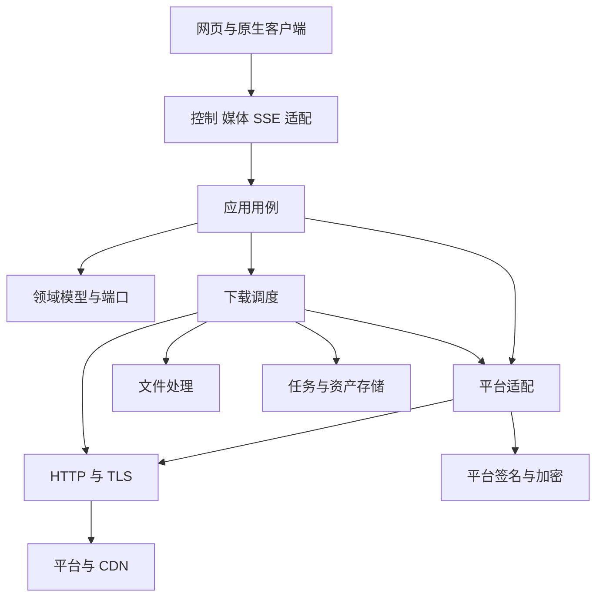

# C++20 重构架构

当前方案与功能分期见[后端设计入口](backend-service/README.md)。本页保留迁移关系和整体分层。

## 服务形式

一个无 GUI 的跨平台常驻后端服务所有外部客户端。后台下载保存到后端目录，客户端另存是独立传输；播放器状态由前端管理。本项目不开发 GUI 或依赖前端运行时；静态网页托管如保留，仅为分发已有客户端资源的可选适配，反向代理或独立前端均可接入。

Windows、Linux、NAS 与 Docker 共用业务层和 API，系统接口限定在适配层，原生程序按目标系统和架构分别构建。支持矩阵和容器要求见[配置与部署](backend-service/configuration-and-deployment.md#部署方式)。

控制、媒体和 SSE 入口共享业务与存储，独立线程池隔离长连接。前端从配置或启动器取得 API 地址，再从 info 获取媒体／事件地址。NAS 路径与容器路径不作为客户端本机路径。

## 分层

框架、JSON、数据库类型限定在适配层。控制请求与媒体连接各有取消期限，持久任务由后端独立管理。执行额度与等待关系见[运行时](backend-service/runtime-and-tasks.md)。

## 原实现映射

| C++ 模块 | 职责 | 参考位置 |
| --- | --- | --- |
| domain | 歌曲、集合、品质、错误与能力模型 | music-lib/model、provider |
| providers | 参数、签名、平台响应与能力差异 | music-lib/各平台 |
| application | 聚合、集合、解析、探测与匹配 | core/service.go、Web／TUI 编排 |
| transport | HTTP、TLS、Range、重定向与取消 | 平台 HTTP、BuildSourceRequest |
| downloads | 队列、临时文件、续传、恢复、去重 | core/download.go、下载记录 |
| audio_processing | 解密、格式、标签、封面与歌词 | core/service.go 元数据处理 |
| storage | 身份、任务、资产与发布意图 | SQLite 与本地存储 |
| api／media_server／event_server | HTTP、二进制与 SSE 协议适配 | internal/web，按新契约重写 |
| runtime | 有界执行器、额度、截止时间、停机 | C++ 服务新增 |

研究依据：[Go Music DL](../../research/go-music-dl/README.md)、[Lanyue](../../research/lanyue/README.md)。

## 迁移要求

- 各源分页、总数和错误分别保留；歌曲 ID 以 source + id 表示。
- 歌单／专辑详情与曲目分页分离，分类／榜单标记实时、内置或派生来源。
- 音源解析、可访问性、试听和格式完整性分别判断；保留未知值。
- 换源保留原曲与实际曲目，区分现场、翻唱、Remix 等版本。
- 音频逐块写盘，Range 续传核对资源身份；必要解密可先落盘后处理。
- 标签失败按策略报告，去重考虑来源、版本和品质。
- 保留原 Go 页面需另设兼容层；自建集合、本地音乐扫描、WebDAV、TUI 属于后续扩展。

## 实现入口

| 内容 | 规范 |
| --- | --- |
| 功能职责 | [功能模块](backend-service/feature-modules.md) |
| 目录与目标 | [模块与目录](backend-service/modules-and-layout.md) |
| 路由与字段 | [API](backend-service/api-contract.md)、[模型](backend-service/data-models.md) |
| 事务与恢复 | [内部契约](backend-service/internal-contracts.md) |
| 验证顺序 | [实施计划](implementation-plan.md) |
