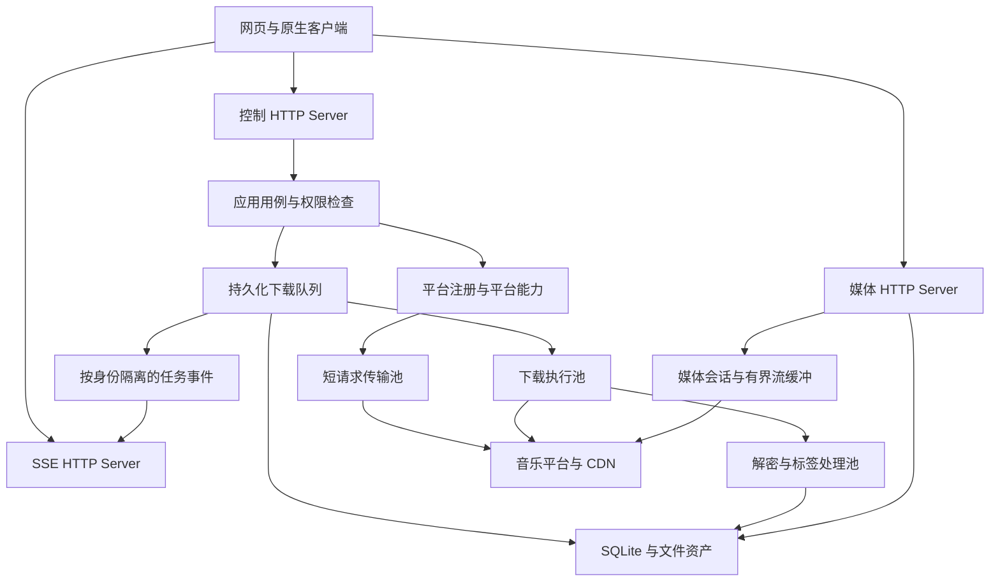

# 音乐后端服务详细设计

更新日期：2026-10-19。设计基线：C++20 + cpp-httplib；Drogon 仅保留备选。本目录只描述设计与接口，没有创建 C++ 工程、源文件、构建脚本或部署产物。

先交付独立、无界面、可常驻运行的服务进程。网页、Electron、Tauri、Qt、Win32 和 CLI 通过相同接口访问它；NAS 与 Docker 属于部署环境。音乐平台协议、凭证、搜索、换源、任务、文件与记录统一由后端维护。

下文 principal 指服务识别的调用方身份；同一用户的多个前端可以共享身份与任务，彼此独立的用户使用不同身份。它不等于某个窗口或一次 HTTP 连接。

## 文档导航与规范归属

| 文档 | 负责定义 |
| --- | --- |
| [功能模块详细设计](feature-modules.md) | 各模块的职责、业务规则、输入输出、协作方式与功能分期 |
| [内部接口与一致性](internal-contracts.md) | 用例／端口操作、对象所有权、执行世代、事务、索引与文件恢复 |
| [关键流程与验收](flows-and-acceptance.md) | 搜索、下载、取消、重连、播放流程及故障验收矩阵 |
| [模块与目录](modules-and-layout.md) | 模块边界、依赖方向、组件职责、拟建目录与构建目标 |
| [模型与存储](data-models.md) | 公共实体、资源身份、分页、任务快照、表与一致性规则 |
| [对外 API](api-contract.md) | 方法、路径、权限、参数、响应、错误、幂等和媒体接口 |
| [运行时与任务](runtime-and-tasks.md) | httplib 接入、线程池、限额、取消、状态机、下载与恢复 |
| [配置与部署](configuration-and-deployment.md) | 配置项、初始默认值、启动与退出、本机／NAS／容器运行 |
| [构建与依赖](build-and-dependencies.md) | C++20、CMake、FetchContent 浅克隆、版本校验、缓存与 CI |

本目录细化并取代[架构总览](../architecture.md)中对应的目录和 API 草案；总览保留业务背景。[技术栈研究](../technology-stack.md)负责候选库证据，本目录负责当前主方案的设计决策。数字上限和超时是首轮验证起点，不是压测结论。

建议阅读顺序：本页确认整体方案 → 功能模块理解业务 → 内部契约明确实现边界 → API 对接前端 → 关键流程核对行为。目录与构建文档用于组织工程，运行时和部署文档用于确定资源与生命周期。字段／路由以 API 为准，持久实体以数据模型为准，配额与配置以运行时／配置文档为准，避免复制出多套规范。

## 核心决策

| 事项 | 当前设计 |
| --- | --- |
| 服务进程 | 一个 `music-dl-server` 进程，统一组装配置、存储、平台注册表和调度器 |
| 控制 API | cpp-httplib Server，版本前缀 `/api/v1`；返回 JSON，执行短业务请求 |
| 媒体出口 | 同进程中另一 cpp-httplib Server，前缀 `/media/v1`，独立线程池 |
| 事件出口 | 同进程独立 cpp-httplib Server，前缀 `/events/v1`，独立 SSE 线程池 |
| 默认地址 | 控制 `127.0.0.1:17632`，媒体 `127.0.0.1:17633`，事件 `127.0.0.1:17634`；均可配置 |
| 对外统一域名 | 反向代理按路径转发三个监听；客户端读取服务公布的媒体和事件地址 |
| HTTP Client | 首轮使用 httplib Client，经传输适配器封装；实例在请求期间独占 |
| 执行模型 | 阻塞网络加有界工作池；不引入协程运行时，不使用无界 `std::async` |
| 构建与获取 | CMake + CMakePresets，FetchContent 获取第三方库，Git 源统一浅克隆 |
| 长任务 | 下载持久化为任务，提交后返回 ID，由服务自行执行 |
| 进度 | SSE 主动推送；HTTP 查询用于初始状态、重连同步和轮询兜底；不引入 WebSocket |
| 持久化 | SQLite 作为详细设计的存储基线，单写入执行器与受限读取连接 |
| JSON | 首轮拟用 nlohmann/json，在 API／平台解析边界内使用；未引入依赖 |
| TLS | 抽象连接配置，实际后端另验；httplib 的系统证书支持不等于原生 Schannel TLS |
| 音频 | 保存原始音频；标签能力可选，通用转码不进入首版必需依赖 |
| 多调用方 | 访问 token 对应 principal；任务、凭证和文件按 principal 授权 |
| 文件位置 | 由服务端配置的目标目录决定；客户端通过文件接口取回 |
| 框架边界 | domain、应用用例和 Provider 不暴露 httplib 类型 |

三个监听共享同一进程和数据库，分别隔离控制、媒体与事件连接。媒体功能可在早期关闭；下载闭环阶段启用 SSE。长响应不占用控制线程池，事件订阅也不消耗媒体播放额度。

## 请求如何经过服务

控制请求持有自己的截止时间；请求结束时，不能留下访问已销毁 Request／Response 的后台回调。下载任务由服务持有，不继承提交请求的断开信号。媒体请求则与消费连接绑定，客户端断开后取消该次上游传输。

## 功能分期

| 阶段 | 可交付范围 | 完成条件 |
| --- | --- | --- |
| S0 运行骨架 | 配置、身份、健康、能力、错误与三类监听的边界 | 无前端也能启动和退出；长连接不挤占控制线程池 |
| S1 单平台闭环 | 歌曲搜索与详情、凭证、音源解析、任务、SSE 进度、文件获取 | 断线重连能恢复任务显示；关闭客户端任务仍执行 |
| S2 平台与集合 | 多平台搜索、歌单／专辑／歌手、分类、榜单、歌词、链接解析 | 正确表达能力差异、各源分页与部分成功 |
| S3 稳定传输 | 持久恢复、资源一致性、元数据、限速、可靠取消与重试 | 断开、重启、磁盘故障、Range 分支有验证依据 |
| S4 媒体与换源 | 播放会话、Range 代理、媒体票据、候选匹配与可选自动换源 | 不混合不同录音的字节；慢消费者占用有界 |
| S5 部署完善 | Windows 常驻管理、Linux／ARM 构建、NAS／容器部署 | 在实际目标环境验证产物、路径、退出和数据持久化 |

API 文档一次定义目标 v1 契约，不表示所有阶段在首次启动时同时实现。`GET /api/v1/info` 声明服务功能，`GET /api/v1/providers` 声明平台能力；未启用服务功能返回 `501 FEATURE_UNAVAILABLE`，平台不支持返回 `422 CAPABILITY_UNSUPPORTED`。

首批接入哪个平台、采用哪一个 TLS／加密库、具体标签格式覆盖仍待专项验证；这不阻碍确定模块与 API 契约。

## 首轮不纳入的功能

不在本轮创建界面、播放器内核、应用商店安装包、分布式任务调度、跨节点共享数据库、自动用户注册、通用转码集群、HLS 生成或任意 URL 下载代理。后续扩展应复用当前领域模型与资源授权，不在平台适配器中引入这些职责。

## 贯穿前后端的约定

1. 平台歌曲用 `source + id` 标识；服务文件、任务、会话分别有自己的 ID。
2. API 返回结构化数据和错误；无结果、未支持、平台失败分别表达。
3. 创建任务成功表示已可靠记录，不代表文件已下载；完成后以 `file_id` 获取资产。
4. 默认不自动换源、不接受试听当整曲；只有明确启用策略才允许降级或替代，并记录实际来源。
5. 下载与导出是两个动作：从平台保存到服务端，再从服务端获取到客户端。
6. 目录路径、Cookie、解密密钥和原始带签名 CDN URL 不作为普通前端契约。
7. 取消与重启恢复是显式状态流转；不能只改 UI 状态或假定旧 URL 永久有效。
8. 文档示例均为虚构数据，用于约定字段与语义。
