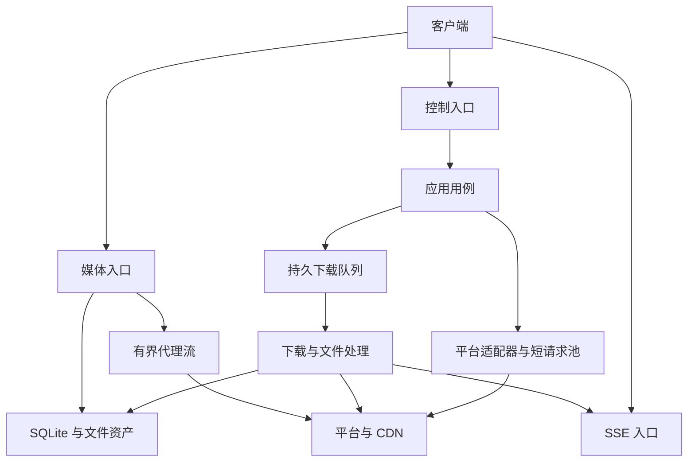

# 音乐后端服务设计

更新：2026-10-19。状态：设计阶段，未实现。

本项目是纯后端，不包含 GUI。独立常驻进程 `music-dl-server` 通过 HTTP 服务网页、Electron、Tauri、Qt、Win32 和 CLI 等外部客户端；必须支持跨平台与 Docker 部署，不依赖桌面会话或前端进程。principal 表示调用方身份，同一身份的多个客户端共享权限与任务。

## 文档导航

| 文档 | 内容 |
| --- | --- |
| [功能模块](feature-modules.md) | 职责与业务规则 |
| [模块与目录](modules-and-layout.md) | 编译依赖、目录和目标 |
| [模块边界](module-boundary-review.md) | 前后端分工与范围限制 |
| [数据模型](data-models.md) | 字段语义、实体与存储 |
| [API](api-contract.md) | 路由、权限、请求、响应与错误 |
| [内部契约](internal-contracts.md) | 端口、所有权、事务与恢复 |
| [运行时](runtime-and-tasks.md) | 线程、配额、任务状态机与流传输 |
| [配置与部署](configuration-and-deployment.md) | 纯后端边界、系统／架构矩阵、跨平台约束、Docker、默认值与生命周期 |
| [构建与依赖](build-and-dependencies.md) | CMake、FetchContent、版本和缓存 |
| [流程与验收](flows-and-acceptance.md) | 时序与故障验收 |

同一规则在对应规范维护，其他文档引用。配额是初始设计值，待目标设备验证；库研究见[技术栈](../technology-stack.md)。

## 核心决策

| 项目 | 方案 |
| --- | --- |
| 语言与构建 | C++20、CMake、CMakePresets；FetchContent 浅克隆、固定 tag 并校验 commit |
| 产品与平台 | 无 GUI 的跨平台后端；Windows／Linux 与 Docker 为必需目标，架构和支持级别以配置与部署为准 |
| 网络 | cpp-httplib Server／Client；Drogon 备选；阻塞 I/O 配合有界工作池 |
| 控制入口 | `127.0.0.1:17632`，`/api/v1` |
| 媒体入口 | `127.0.0.1:17633`，`/media/v1` |
| 事件入口 | `127.0.0.1:17634`，`/events/v1` |
| 入口隔离 | 同进程共享业务和数据库，各入口独立线程池；反向代理可统一 origin |
| 地址发现 | API 地址由部署配置或启动器交付；媒体／SSE 地址从 info 获取，禁止推算端口 |
| 下载 | 持久任务，提交后由后端执行，文件保存到后端 destination |
| 进度 | SSE 推送与独立 HTTP 查询共用任务快照 |
| 媒体访问 | 复用 asset_id／file_id，提供可选代理或受控直链 |
| 播放与客户端保存 | 前端管理播放器和本机保存；后端完成不代表客户端已落盘 |
| 持久化 | SQLite，单 writer 与受限读连接 |
| JSON | nlohmann/json 用于协议边界 |
| 音频 | 原始编码保存，标签可选，转码非必需 |
| 授权 | token 对应 principal，任务、文件、凭证按身份隔离 |
| 默认策略 | 自动换源关闭、品质 strict、拒绝明确试听 |
| 待定 | 首批音乐平台、TLS／协议加密实现、标签覆盖和匹配阈值 |

业务公共类型不暴露 httplib、JSON 或 SQLite 类型。S1 启用文件出口与必要票据；在线代理独立开关。平台、任务、文件和已解析音源分别使用 source/id、task_id、file_id、asset_id。

## 运行结构

## 功能分期

| 阶段 | 交付 | 完成条件 |
| --- | --- | --- |
| S0 | 配置、身份、健康、能力、存储、入口隔离 | Windows／Linux 无界面构建与独立启停通过，建立最小容器启动验证，初始化失败明确 |
| S1 | 单平台搜索／解析、下载、SSE／HTTP 进度、文件获取与票据 | 关闭前端任务继续，重连恢复状态，能取回文件 |
| S2 | 多平台、歌单／专辑／歌手、分类、榜单、歌词、链接解析 | 能力差异、分页和部分失败正确 |
| S3 | 续传、处理、限速、重试与恢复 | 断网、重启、磁盘和发布故障不产生伪完成或混合文件 |
| S4 | 在线代理／直链、匹配与受控自动换源 | 资源身份一致，慢消费者占用有界 |
| S5 | 系统服务集成、多架构发布、NAS 与 Docker／Compose 交付 | 按支持矩阵完成目标环境启停、权限、停止信号、持久数据与升级验证 |

S1 已包含最小安全发布与重启处理；S3 扩展故障覆盖。服务功能通过 info 声明，平台能力通过 providers 声明，未启用／不支持分别返回 501／422。

跨平台与容器兼容属于 S0 起的持续约束，S5 完成部署集成与发布验证。系统、CPU 架构、运行库与部署形态分别记录，只有经过验证的组合才声明正式支持，见[配置与部署](configuration-and-deployment.md)。

首版范围外：播放器内核、跨设备播放同步、完整后台歌单枚举、用户注册、分布式调度、共享数据库多副本、通用转码集群、HLS 和任意 URL 代理。
