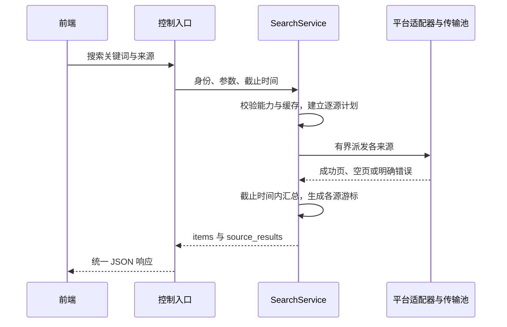
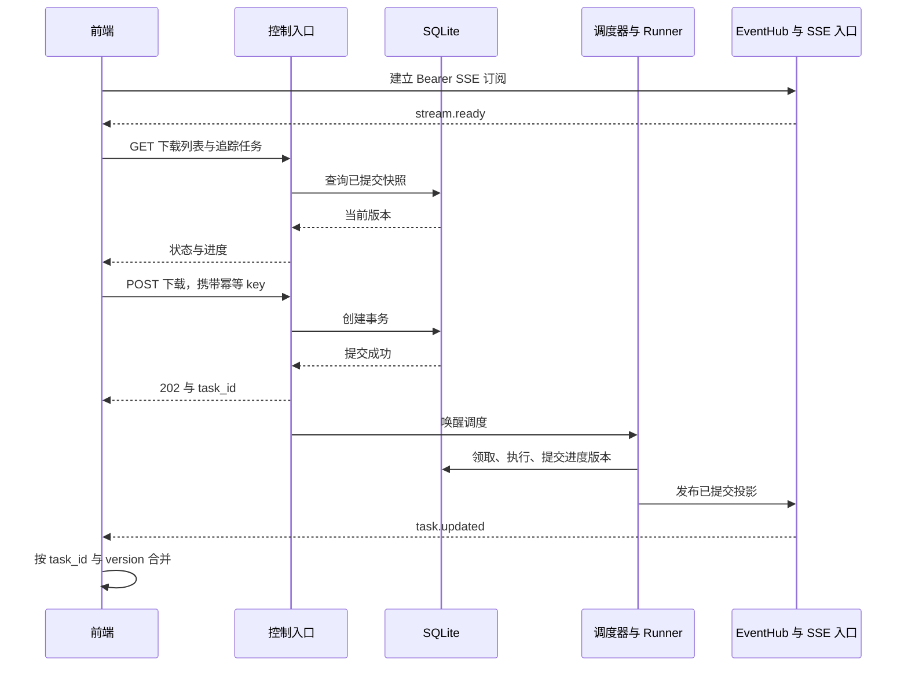
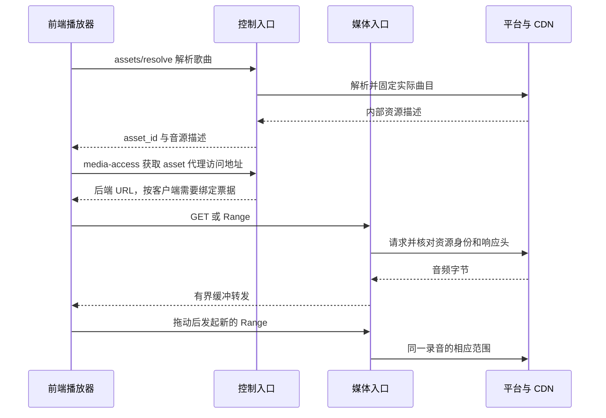

# 后端关键流程与验收设计

流程与验收基于 [API](api-contract.md)、[内部契约](internal-contracts.md)和[运行时](runtime-and-tasks.md)。

## 1. 多平台搜索

一个来源失败时其他来源结果仍可使用；没有结果必须是已执行成功的空页。下一页只针对一个来源，不能把“所有来源第一页的聚合”当成可继续的全局分页。

验收时用可控假平台分别返回成功、空页、慢响应和格式错误。验证部分结果、截止时间、每来源游标及凭证隔离，不依赖真实平台长期在线来验证编排本身。

## 2. 下载提交到实时显示

任务提交成功和 SSE 事件到达顺序不作为前端假设：任务事件可能先于 POST 响应出现，客户端按 task_id 合并，不能凭收到两条消息就显示两个下载。

完成事件到达后查询完整 Task 获取 file_id、错误或警告。只使用 HTTP 的客户端按同一 task_id 查询同一份状态，不需要补建任何事件会话。

## 3. 取消与发布竞争

取消先成功：事务将活动状态转 canceling，Runner 的旧版本 checkpoint 被拒绝，当前传输停止，在安全点清理工作文件后转 canceled。canceling 期间界面不能显示已经停止消耗资源。

发布先成功：事务进入 finalizing 并写入意图，后来的取消返回 TASK_FINALIZING。发布完成后只读资产存在，任务为 completed；不能用取消悄悄删除结果文件。

验证应精确控制取消与“进入 finalizing”两个操作的先后，分别验证合法结果；仅反复点击 UI 不能覆盖这个竞争窗口。停止信号发出后还需确认网络句柄退出和额度归还。

## 4. 断线、重连和 HTTP 兜底

前端断开 SSE 时后端下载继续；重连后先注册，收到 ready，再读取任务列表和已有追踪任务，最后按版本合并期间收到的事件。服务重启后临时订阅全部重建，持久任务按恢复规则继续或报告错误。

若 SSE 不受客户端环境支持，或订阅限额导致连接暂时不可用，前端可独立查询 HTTP 列表／任务。保持实时连接的客户端不需要同时每秒查询全部任务；查询用于同步、获取详情和主动刷新。

默认没有事件重放，因此无法保证显示断线期间每一个进度值，但必须恢复最新状态。对“断线时正在下载、重连时已完成”的任务，不允许只查活动列表而永久遗漏完成结果。

## 5. 前端播放与后端媒体访问

本地已完成文件走同样的媒体授权和 Range 规则，但不请求平台。播放代理不改变音频编码，前端是否支持该编码必须单独判断；不支持时明确提示，未来才扩展可选转码。

上图为可选代理路径；直链模式则在 media-access 返回地址后，由前端直接访问平台，音频字节不经过后端。暂停、切歌、倍速、音量、解码与位置恢复均由前端执行，后端没有对应播放命令或状态。

代理流断开只取消自己的上游读取，不能停止同一歌曲的独立下载任务。asset 过期重新解析得到新 asset_id，由前端替换地址并决定是否恢复进度；录音或字节表示变化时不能把不同资源拼成一条流。

“下载到音乐库”由后端任务保存至后端目录，“保存到此设备”由客户端读取已完成文件并落盘。第二段传输可以失败而第一段仍为 completed；客户端不得以服务端 SSE 的 100% 宣称本机保存成功。直接流式保存在线媒体属于客户端传输，不承诺关闭客户端后继续。

## 6. 全歌单下载

客户端先查询详情和分页曲目，显示可选择范围；选定后将 TrackRef 分组提交批次，每批独立幂等。后端保存提交时的任务输入，之后歌单更新不自动改变已接收任务。

多个批次的提交不是一个大事务。网络中断后用原批次幂等 key 恢复，不能重新生成全部 key 再提交；复用策略只能作为额外保护，不能替代幂等。

未能取得完整歌单时 UI 应显示已加载范围。平台曲目不可访问、分页失败、无下载资源是不同阶段的结果，不可把搜索／列表成功当成整歌单可下载保证。

## 7. 故障与验收矩阵

以下场景的实施责任和首次／后续验收阶段见[开发任务的验收映射](../development-tasks.md#验收场景责任映射)。本页维护行为规则，任务清单负责安排落实顺序。

| 编号 | 触发条件 | 必须观察到的结果 |
| --- | --- | --- |
| A01 | 重复 POST，同 key 同输入 | 返回同一创建结果，没有重复任务 |
| A02 | 同 key 不同品质 | 409，无第二次副作用 |
| A03 | 并发同指纹任务 | 去重／明确冲突，不绕过活动唯一约束 |
| A04 | 关闭前端 | 后端下载继续，重开可查询 |
| A05 | 多源中一个超时 | 返回其他来源，失败源有明确原因 |
| A06 | 两个 principal 同平台不同账号 | 请求头、缓存、任务与 SSE 无串用 |
| A07 | SSE 占满允许订阅数 | 搜索和取消仍由控制池处理，新订阅按配额拒绝 |
| A08 | SSE 消费者不读取 | 缓冲受限、写超时或关闭，不拖住 Runner |
| A09 | SSE 断线期间任务完成 | 重连 HTTP 同步获取终态与 file_id |
| A10 | SSE 投影先于创建响应 | 前端合并成同一任务 |
| A11 | 低版本进度迟到 | 不覆盖新版本／终态 |
| A12 | 取消与发布同时发生 | 根据事务顺序得到 canceled 或发布完成，无矛盾状态 |
| A13 | 请求 Range，上游返回 200 | 按重下或代理实际响应规则处理，不误追加 |
| A14 | 返回错误 206／资源身份变化 | 拒绝续传，不混合文件 |
| A15 | 上游 416 | 验证完整性后决定完成或重下，不仅凭状态码判完成 |
| A16 | CDN URL 过期 | 重新解析并校验身份，预算内有限重试 |
| A17 | 写盘失败／目标离线 | 停止读取，明确文件错误，不标 completed |
| A18 | 标签可选失败 | 音频完成，metadata_status 和 warnings 一致 |
| A19 | 必需解密／验证失败 | 不发布损坏音频 |
| A20 | 进程在文件移动后退出 | 恢复依据意图补提交，不覆盖未知目标文件 |
| A21 | DB 提交后、SSE 发布前退出 | 重连查到持久状态，无重复下载 |
| A22 | 旧执行回调在新执行后到达 | execution_id／version 拒绝写入 |
| A23 | 票据过期／他人 file_id | 按授权契约拒绝，不暴露路径或秘密 |
| A24 | 播放器拖动与断开 | Range 正确，旧流资源回收 |
| A25 | 未知 Content-Length | total_bytes／ETA 合理为 null，不伪造百分比 |
| A26 | 长期重试与重启 | 总 deadline、已用 attempt 不重置 |
| A27 | 正常服务停机 | 停止领取，等待者唤醒，检查点保留，DB 最后关闭 |
| A28 | 未启动 SSE、仅 HTTP 查询 | 下载全部操作和进度查询仍可用 |
| A29 | 后端 NAS 下载完成，客户端保存中断 | 后端任务仍 completed，客户端显示自己的保存失败 |
| A30 | 同一账号两个播放器分别暂停／切歌 | 无服务端共享播放状态，两端互不操控 |
| A31 | 资源需要秘密头，客户端请求 direct | 按模式拒绝或 auto 选择 proxy，不外发秘密 |
| A32 | 只有票据过期／asset 自身过期 | 分别重新获取访问描述／重新解析，不用票据延寿 |
| A33 | media_proxy 关闭但 file_access 开启 | 已完成文件获取正常，不调用上游代理 |
| A34 | token 已撤销但引导文件尚在 | 不从引导文件恢复 token，SQLite 授权事实有效 |
| A35 | 同曲目分别提交 skip／required，或 allow_preview=true／false | 不同意图不互相复用；required 不接受未满足标签要求的完成文件，拒绝试听请求不复用 preview |
| A36 | 同原曲手动选择两个不同目标；另以两个新 match 句柄选择同一目标 | 不同目标指纹不同；其余条件相同时同目标指纹相同，不依赖临时 match_id |
| A37 | 接收手动目标后句柄过期／服务重启；或同 key 重放 | 排队与 retry 使用持久目标；幂等重放不重新读取过期句柄，仍返回首次结果 |
| A38 | 同 principal、同 source，两个 credential_id 都为 version=1；或同应用不同 scope 的 token 都为 version=1 | 完整身份键区分凭证／应用 token 条目；相同查询仍使用独立缓存／上下文／连接身份，默认账号切换后的旧游标返回 410 |
| A39 | 更新／刷新凭证时旧查询迟到；任务排队后切换默认账号 | 旧结果只写旧身份分区；任务使用已固定绑定的最新版本，不改用另一默认账号 |
| A40 | 同一凭证并发刷新，期间人工更新或撤销 | 只有一次刷新在途，等待者各自可超时；旧结果 CAS 失败且不复活凭证，秘密不进入日志或普通 DTO |
| A41 | 新增不同授权协议的模拟平台；声明刷新却未注册工厂 | 正常接入只增加平台包／注册／样本；不完整或重复绑定在启动发现，未实现能力不对外声明 |
| A42 | spotify 目录查询后从 youtube 下载，CDN 重定向到另一 origin | 每段按实际 source／origin 获得租约，旧跳完成后重新入场；不长期占 spotify 下载额度 |
| A43 | 一个来源达到容量／冷却，另一个来源可用 | 不在短请求 worker 内等 semaphore；其他来源可推进；下载持久延后后释放执行槽，无部分预留泄漏 |
| A44 | 同一任务多次 admission 延后，随后真正上游失败 | 延后不增加 attempt；重新领取更换 execution_id 并拒绝旧回调；真正新尝试才计数，原 deadline 不延长 |
| A45 | 两个来源共享应用配额组，刷新 token；helper 超时但仍在退出 | 共享组的冷却／速率窗口不重置；helper 按声明上界计量一次，真实退出前不归还进程／连接额度 |
| A46 | 完成结果的文件缺失／证据不满足，或复用检查后资产版本变化 | 不返回错误的 reused=true；条件复核阻止旧证据提交，重新核验或创建新任务，不覆盖原资产 |
| A47 | 默认凭证设置／清除／并发设置、撤销默认凭证，或 A→B→A 后使用旧句柄 | owner/source 校验有效；引用与选择世代原子提交并跨重启保留；不自动改选其他用户账号；旧默认游标失效，已受理任务仍使用原绑定 |
| A48 | 服务运行时执行身份管理；签发交付文件冲突或 DB 失败；撤销 token 后保留旧输出／引导文件 | 有实例锁则拒绝离线管理；不覆盖交付文件、不输出秘密；未提交的 token 无效；重启不导入旧文件复活凭证，其他 token 不受撤销影响 |
| A49 | 修改已注册 destination 的根、移除在用项，或新增目标并停用旧项的新任务入口 | 改根／移除在用项在恢复前明确拒绝；新 ID 不重定向旧 file_id；旧文件与已受理任务仍使用原根及当前 ACL；停用项不接受新任务或 retry |
| A50 | 展示 320000 bit/s 音频；下载剩余 4200000 字节、速度 700000 byte/s | bitrate_bps 为码率，speed_bytes_per_second 为字节速度；HTTP／SSE 一致，ETA 为 6000 ms；未知值仍为 null，不出现八倍换算错误 |

## 8. 验证层次与实施关口

纯领域验证覆盖品质选择、匹配排除规则、任务迁移、幂等输入归一与重试分类；离线 Provider 样本验证请求构造、签名向量和解析。不能让协议测试只检查自己生成的输入等于自己输出。

集成环境使用本地可控上游模拟慢响应、断流、Range、错误头和认证变化；使用临时数据库与目录验证事务和发布崩溃窗口。HTTP／SSE 契约验证关注客户端实际收到的数据、授权和重连行为。

真实音乐平台验证单独执行，记录来源、账号条件、时间和结果，避免将网络不稳定混为内部状态机失败。运行平台按[部署矩阵与发布验证要求](configuration-and-deployment.md#部署方式)分别记录系统、架构、运行库、构建与运行结果；从 S0 开始覆盖 Windows／Linux 和最小容器，不以单一开发机或交叉编译通过代替目标运行验证。

部署验收须在无 GUI、无前端的环境执行健康、HTTPS、下载与正常停止；同时验证中文与长路径、服务账户权限、证书来源、容器非 root 与端口映射、SIGTERM 收尾、重建容器后的持久数据恢复。数据库与下载目录按部署约束选择文件系统，NAS／网络挂载须验证离线与发布失败；已发布组合升级后仍需验证迁移、备份与重启恢复。

阶段交付需完成对应验收；未验证能力保持关闭。压测报告记录线程、连接、内存、任务数与延迟条件。

分期与责任只在[任务验收映射](../development-tasks.md#验收场景责任映射)维护，包括 R1～R4 和本轮 A47～A50。领域样本先验证未来功能的基础规则，真实标签、授权、匹配仍在对应任务验收；不把文档或模拟通过记成在线能力已交付。

## 9. 平台扩展验收

新增平台另执行[扩展契约验收](provider-extensibility.md#9-新平台交付模板与验收)：至少覆盖目录型与音源型能力组合、100 个模拟来源的分页与按需初始化、跨账号 OAuth 刷新／撤销竞争、Spotify 目录到实际音频来源的身份保留、外部 helper 取消／崩溃、上下文升级与平台禁用后的恢复。S1 先以酷我和模拟适配器验证公共边界，外部工具和目录换源随对应阶段验收；不把未实现扩展作为首个下载闭环的前置条件。
