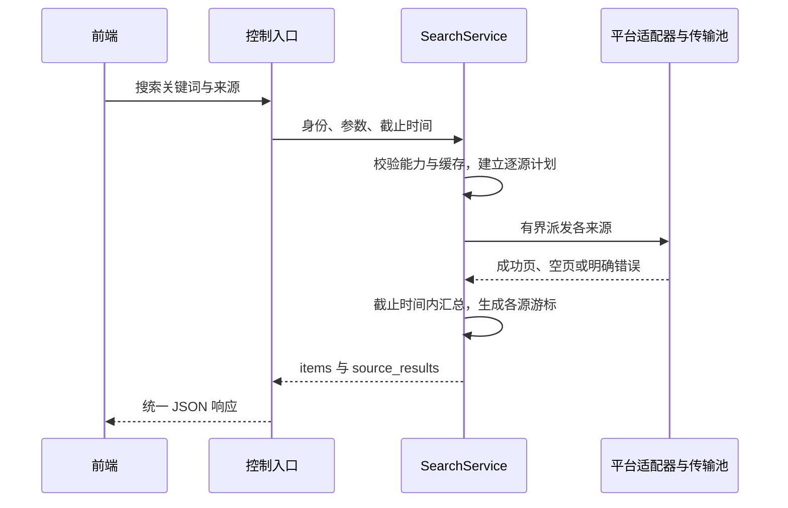
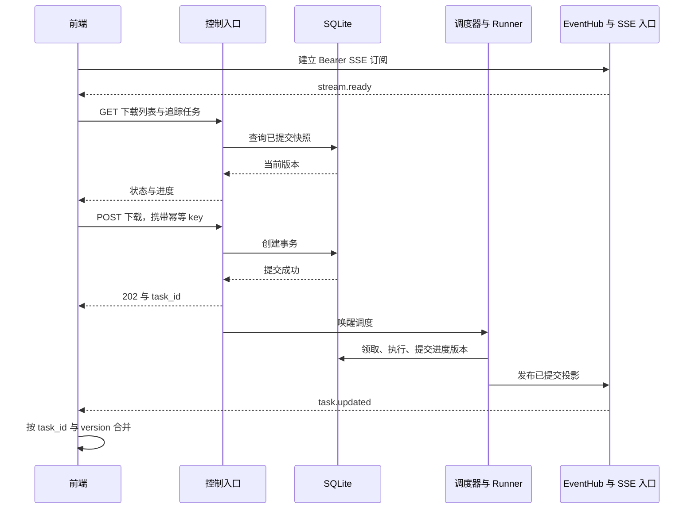
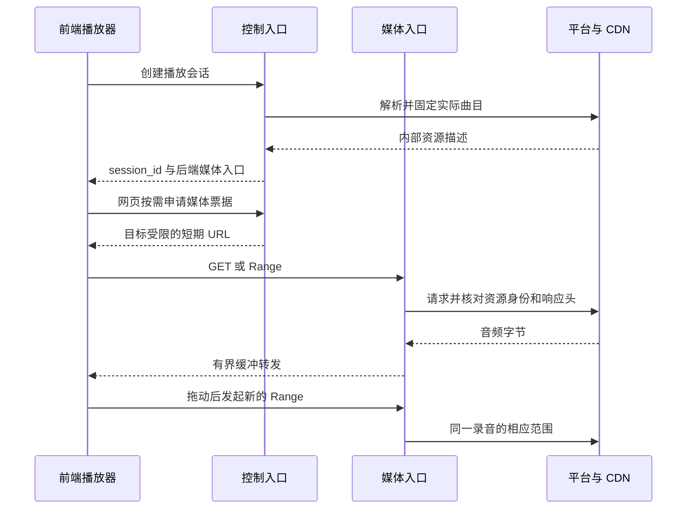

# 后端关键流程与验收设计

本文以可观察行为串联[功能模块](feature-modules.md)、[内部契约](internal-contracts.md)和 [HTTP API](api-contract.md)。下列都是实施阶段要满足的条件，不代表已经运行验证。固定配额与超时沿用[运行时设计](runtime-and-tasks.md)。

## 1. 多平台搜索

一个来源失败时其他来源结果仍可使用；没有结果必须是已执行成功的空页。下一页只针对一个来源，不能把“所有来源第一页的聚合”当成可继续的全局分页。

验收时用可控假平台分别返回成功、空页、慢响应和格式错误。验证部分结果、截止时间、每来源游标及凭证隔离，不依赖真实平台长期在线来验证编排本身。

## 2. 下载提交到实时显示

任务提交成功和 SSE 事件到达顺序不作为前端假设：任务事件可能先于 POST 响应出现，客户端按 task_id 合并，不能凭收到两条消息就显示两个下载。

完成事件到达后查询完整 Task 获取 file_id、错误或警告。只使用 HTTP 的客户端按同一 task_id 查询同一份状态，不需要补建任何事件会话。

## 3. 取消与发布竞争

取消先成功：事务将活动状态转 canceling，Runner 的旧版本 checkpoint 被拒绝，当前传输停止，在安全点清理工作文件后转 canceled。canceling 期间界面不能显示已经停止消耗资源。

发布先成功：事务进入 finalizing 并写入意图，后来的取消返回 TASK_FINALIZING。发布完成后只读资产存在，任务为 completed；不能用取消悄悄删除结果文件。

验证应精确控制取消与“进入 finalizing”两个操作的先后，分别验证合法结果；仅反复点击 UI 不能覆盖这个竞争窗口。停止信号发出后还需确认网络句柄退出和额度归还。

## 4. 断线、重连和 HTTP 兜底

前端断开 SSE 时后端下载继续；重连后先注册，收到 ready，再读取任务列表和已有追踪任务，最后按版本合并期间收到的事件。服务重启后临时订阅全部重建，持久任务按恢复规则继续或报告错误。

若 SSE 不受客户端环境支持，或订阅限额导致连接暂时不可用，前端可独立查询 HTTP 列表／任务。保持实时连接的客户端不需要同时每秒查询全部任务；查询用于同步、获取详情和主动刷新。

默认没有事件重放，因此无法保证显示断线期间每一个进度值，但必须恢复最新状态。对“断线时正在下载、重连时已完成”的任务，不允许只查活动列表而永久遗漏完成结果。

## 5. 播放与拖动进度

本地已完成文件走同样的媒体授权和 Range 规则，但不请求平台。播放代理不改变音频编码，前端是否支持该编码必须单独判断；不支持时明确提示，未来才扩展可选转码。

播放流断开会取消自己的上游读取，不能停止同一歌曲的独立下载任务。换源选定其他录音必须新建会话；不能把前一首的开头与后一首的结尾拼成一条流。

## 6. 全歌单下载

客户端先查询详情和分页曲目，显示可选择范围；选定后将 TrackRef 分组提交批次，每批独立幂等。后端保存提交时的任务输入，之后歌单更新不自动改变已接收任务。

多个批次的提交不是一个大事务。网络中断后用原批次幂等 key 恢复，不能重新生成全部 key 再提交；复用策略只能作为额外保护，不能替代幂等。

未能取得完整歌单时 UI 应显示已加载范围。平台曲目不可访问、分页失败、无下载资源是不同阶段的结果，不可把搜索／列表成功当成整歌单可下载保证。

## 7. 故障与验收矩阵

| 编号 | 触发条件 | 必须观察到的结果 |
| --- | --- | --- |
| A01 | 重复 POST，同 key 同输入 | 返回同一创建结果，没有重复任务 |
| A02 | 同 key 不同品质 | 409，无第二次副作用 |
| A03 | 并发同指纹任务 | 去重／明确冲突，不绕过活动唯一约束 |
| A04 | 关闭前端 | 后端下载继续，重开可查询 |
| A05 | 多源中一个超时 | 返回其他来源，失败源有明确原因 |
| A06 | 两个 principal 同平台不同账号 | 请求头、缓存、任务与 SSE 无串用 |
| A07 | SSE 占满允许订阅数 | 搜索和取消仍由控制池处理，新订阅按配额拒绝 |
| A08 | SSE 消费者不读取 | 缓冲受限、写超时或关闭，不拖住 Runner |
| A09 | SSE 断线期间任务完成 | 重连 HTTP 同步获取终态与 file_id |
| A10 | SSE 投影先于创建响应 | 前端合并成同一任务 |
| A11 | 低版本进度迟到 | 不覆盖新版本／终态 |
| A12 | 取消与发布同时发生 | 根据事务顺序得到 canceled 或发布完成，无矛盾状态 |
| A13 | 请求 Range，上游返回 200 | 按重下或代理实际响应规则处理，不误追加 |
| A14 | 返回错误 206／资源身份变化 | 拒绝续传，不混合文件 |
| A15 | 上游 416 | 验证完整性后决定完成或重下，不仅凭状态码判完成 |
| A16 | CDN URL 过期 | 重新解析并校验身份，预算内有限重试 |
| A17 | 写盘失败／目标离线 | 停止读取，明确文件错误，不标 completed |
| A18 | 标签可选失败 | 音频完成，metadata_status 和 warnings 一致 |
| A19 | 必需解密／验证失败 | 不发布损坏音频 |
| A20 | 进程在文件移动后退出 | 恢复依据意图补提交，不覆盖未知目标文件 |
| A21 | DB 提交后、SSE 发布前退出 | 重连查到持久状态，无重复下载 |
| A22 | 旧执行回调在新执行后到达 | execution_id／version 拒绝写入 |
| A23 | 票据过期／他人 file_id | 按授权契约拒绝，不暴露路径或秘密 |
| A24 | 播放器拖动与断开 | Range 正确，旧流资源回收 |
| A25 | 未知 Content-Length | total_bytes／ETA 合理为 null，不伪造百分比 |
| A26 | 长期重试与重启 | 总 deadline、已用 attempt 不重置 |
| A27 | 正常服务停机 | 停止领取，等待者唤醒，检查点保留，DB 最后关闭 |
| A28 | 未启动 SSE、仅 HTTP 查询 | 下载全部操作和进度查询仍可用 |

## 8. 验证层次与实施关口

纯领域验证覆盖品质选择、匹配排除规则、任务迁移、幂等输入归一与重试分类；离线 Provider 样本验证请求构造、签名向量和解析。不能让协议测试只检查自己生成的输入等于自己输出。

集成环境使用本地可控上游模拟慢响应、断流、Range、错误头和认证变化；使用临时数据库与目录验证事务和发布崩溃窗口。HTTP／SSE 契约验证关注客户端实际收到的数据、授权和重连行为。

真实平台验证单独执行，记录平台、账号条件、时间和结果，避免将网络不稳定混为内部状态机失败。目标系统构建验证还要覆盖 Windows、计划支持的 Linux／NAS 架构、TLS 信任根和依赖获取。

进入下一阶段前至少完成本阶段新增的实际行为验证；无法即时取消的依赖、未确认的标签格式、未校准的匹配阈值不得被能力描述包装成“已验证支持”。压测报告记录线程、活动连接、内存、任务数与延迟条件，不承诺没有证据的统一并发数。

文档阶段完成标准：规范之间字段／路由一致、各模块职责和持久状态有明确归属、关键失败有恢复路径、索引可导航。当前阶段不创建测试工程，也不把文档静态检查称为后端功能测试通过。
