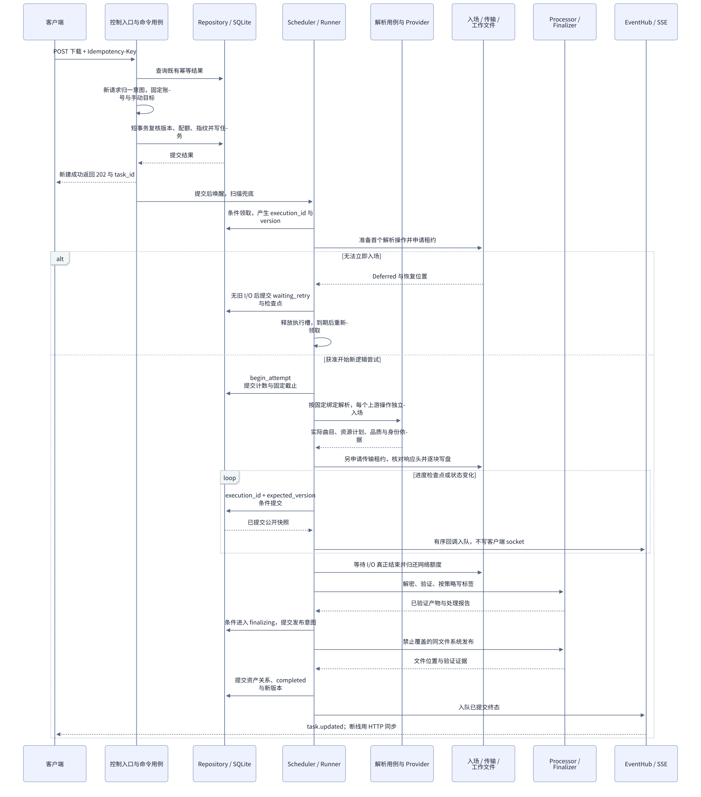

# 架构图集

更新：2026-10-19。这些图表达目标设计，业务尚未实现。评估见[架构总览](../architecture.md)，各图解释与编辑源见[详细架构图](../architecture-details.md)。SVG 可独立打开、缩放或插入文档；中文字体优先使用 Microsoft YaHei，其他系统可安装 Noto Sans CJK SC。

| 图 | 导出文件 | 内容 |
| --- | --- | --- |
| 1 | [系统总览 SVG](overview-1.svg)／[PNG](overview-1.png) | 外部客户端、三入口、单进程、存储与上游 |
| 2 | [编译依赖 SVG](detail-1.svg) | CMake 依赖方向与待实现组装 |
| 3 | [用例与平台 SVG](detail-2.svg) | 应用规则、Provider 与授权（图中的外部适配部分已不在计划内） |
| 4 | [下载时序 SVG](detail-3.svg) | 创建、入场、执行、发布与通知 |
| 5 | [资源调度 SVG](detail-4.svg) | 线程池、额度、持久延后与背压 |
| 6 | [发布与恢复 SVG](detail-5.svg) | 取消竞争、文件移动与 DB 提交窗口 |
| 7 | [媒体与事件 SVG](detail-6.svg) | 文件、在线代理、直链、SSE 与 HTTP 同步 |

## 重新生成

从仓库根目录执行，需 Node.js、npm 以及渲染器可用的浏览器环境。图源保存在 Markdown，不单独维护重复的 `.mmd` 文件。以下命令使用本次验证的 CLI 版本，输出编号按 Markdown 中图表出现顺序生成。

```powershell
npx --yes --package @mermaid-js/mermaid-cli@12.0.0 mmdc -i docs/design/cpp20-refactor/architecture.md -o docs/design/cpp20-refactor/diagrams/overview.svg -c docs/design/cpp20-refactor/diagrams/mermaid-config.json --no-font-embed -j 1
npx --yes --package @mermaid-js/mermaid-cli@12.0.0 mmdc -i docs/design/cpp20-refactor/architecture-details.md -o docs/design/cpp20-refactor/diagrams/detail.svg -c docs/design/cpp20-refactor/diagrams/mermaid-config.json --no-font-embed -j 2
npx --yes --package @mermaid-js/mermaid-cli@12.0.0 mmdc -i docs/design/cpp20-refactor/architecture.md -o docs/design/cpp20-refactor/diagrams/overview.png -c docs/design/cpp20-refactor/diagrams/mermaid-config.json -j 1
```

渲染配置只影响导出样式，节点、关系与说明以 Markdown 图源为准。图表渲染与文档检查不属于业务功能测试。

## 系统总览



## 编译依赖



## 用例与平台



## 下载时序



## 调度与资源



## 发布与恢复



## 媒体与事件


